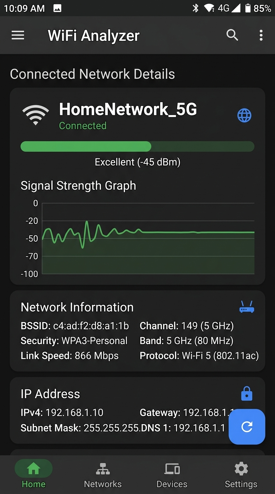
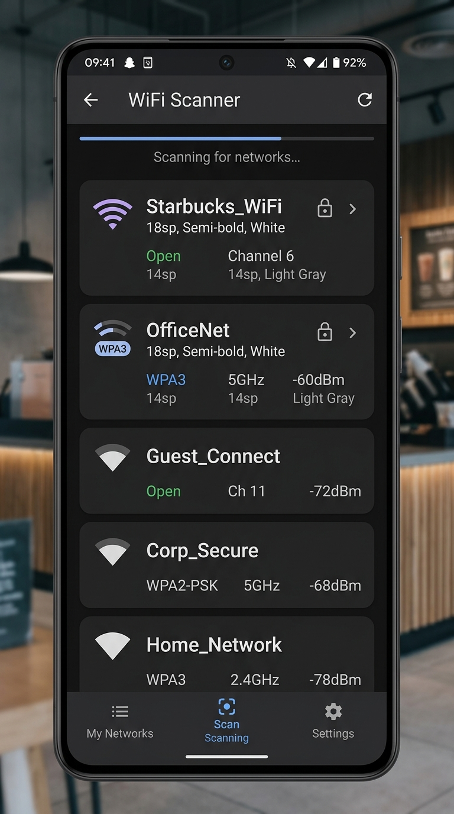
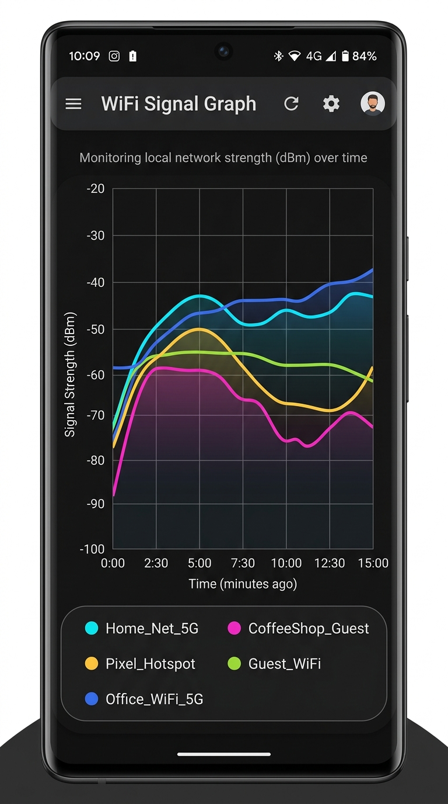
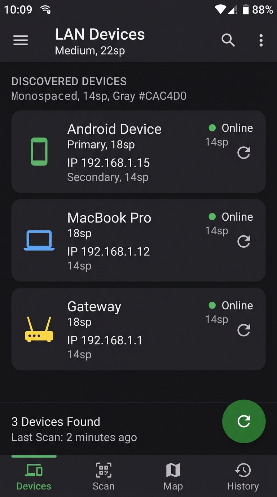
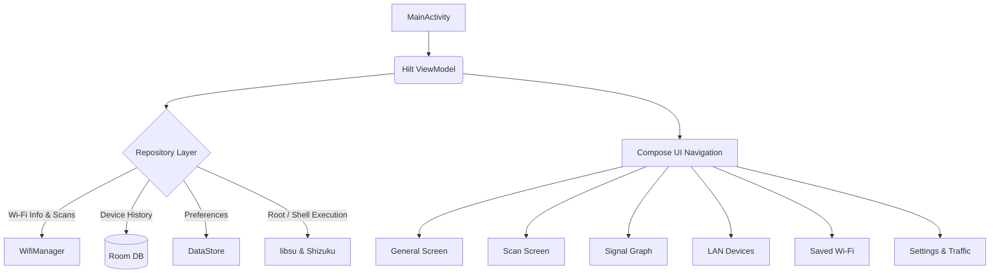

<div align="center">
  
  <h1>📶 WiFi Analyzer (Android)</h1>
  <p><strong>A comprehensive, modern Android application for analyzing Wi-Fi networks, device discovery, and telemetry.</strong></p>

  <p>
    
    
    
    
    
  </p>
</div>

---

## 🚀 Features

*   **📡 Connected Network Details:** View SSID, BSSID, Signal Strength (RSSI), Link Speed, and IP details (IPv4/IPv6/Public IP). Includes a live 60-second signal chart.
*   **🔍 Wi-Fi Scanner:** Discover nearby Access Points (APs). View capabilities, channel, band (2.4/5/6 GHz), security (WPA2/WPA3/WEP), and manufacturer OUI lookup.
*   **📊 Signal Graph:** Live comparison chart to visualize and compare the signal strength of nearby networks by frequency band.
*   **📱 LAN Device Discovery (ARP):** Scan and persist devices connected to your network with IP, MAC, and online/offline status tracking.
*   **🌐 Traffic Monitor:** Track live upload and download speeds globally on your device using `TrafficStats`.
*   **🔗 Wi-Fi Direct (P2P):** Check Wi-Fi Direct availability and manage peer groups.
*   **📶 SIM & Cellular Telemetry:** View SIM state, operator name, network type (LTE/5G/EDGE), without requiring intrusive phone permissions by default.
*   **🔑 Saved Wi-Fi:** View saved Wi-Fi networks and their passwords (requires Root or Shizuku).
*   **🎨 Dynamic Theming:** System, Light, and Dark themes built with Jetpack Compose Material 3.

---

## 📸 Screenshots

> *Replace the image URLs below with actual screenshots of your app running.*

| General Info | Scan Results | Signal Graph | Device Discovery |
| :---: | :---: | :---: | :---: |
|  |  |  |  |

---

## 🛡️ Privileged Access (Root & Shizuku)

The app gracefully degrades if privileged access is unavailable. It detects the presence of `libsu` or **Shizuku** and adjusts its behavior:

| Feature | 👤 Standard (No Privileges) | 💧 Shizuku | ⚡ Root (Superuser) |
| :--- | :--- | :--- | :--- |
| **Basic Wi-Fi Info** | ✅ Yes | ✅ Yes | ✅ Yes |
| **Wi-Fi Scanning** | ✅ Yes (May be throttled by OS) | ✅ Yes | ✅ Yes (Bypass OS throttling) |
| **ARP Table (LAN Devices)** | ⚠️ Restricted on Android 10+ (Reads `/proc/net/arp`) | ⚠️ Restricted | ✅ Full Access (Reads routing tables) |
| **Saved Passwords** | ❌ No | ✅ View saved Wi-Fi passwords | ✅ View saved Wi-Fi passwords |
| **Per-App Traffic** | ❌ No | ❌ No | ✅ Track traffic per application |

---

## 🛠️ Technologies & Architecture

This project is built using modern Android development practices:

*   **[Kotlin](https://kotlinlang.org/):** Modern, expressive language for Android.
*   **[Jetpack Compose](https://developer.android.com/jetpack/compose):** Declarative UI toolkit.
*   **[Material Design 3 (M3)](https://m3.material.io/):** Next-gen theming and components.
*   **[Dagger Hilt](https://dagger.dev/hilt/):** Dependency Injection.
*   **[Room Database](https://developer.android.com/training/data-storage/room):** Local SQLite persistence for discovered ARP devices.
*   **[DataStore](https://developer.android.com/topic/libraries/architecture/datastore):** Preferences management (Theming).
*   **[libsu](https://github.com/topjohnwu/libsu):** Robust root access handling.
*   **[Shizuku](https://shizuku.rikka.app/):** Securely access system APIs without requiring root.

### 🏗️ Flowchart (App Architecture)



---

## 📁 File Structure

```text
WiFi_Analyzer/
├── app/
│   ├── build.gradle.kts          # App-level build script
│   └── src/main/
│       ├── AndroidManifest.xml   # App permissions and configuration
│       └── java/com/rtwifianalyzer/app/
│           ├── MainActivity.kt   # Entry point
│           ├── data/             # Repositories, Room DAOs, DataStore
│           ├── di/               # Hilt Dependency Injection modules
│           ├── domain/           # Data models (WifiSnapshot, NetworkDevice)
│           ├── ui/               # Compose UI, Navigation, ViewModel
│           └── util/             # Helper classes (OUI Lookup, Clipboard)
├── build.gradle.kts              # Project-level build script
└── progress.md                   # Development progress tracker
```

---

## ⚙️ Requirements & Permissions

### Minimum Requirements
*   **OS:** Android 8.0 (API Level 26) or higher.
*   **Target:** Android 15 (API Level 35).
*   **Hardware:** Device with Wi-Fi capabilities.

### Requested Permissions
*   `ACCESS_FINE_LOCATION`: Required by Android to perform Wi-Fi scans and read BSSID/SSID.
*   `NEARBY_WIFI_DEVICES`: Required on Android 13+ (API 33+) for Wi-Fi Direct and certain networking features (declared with `neverForLocation`).
*   `INTERNET`: Required to fetch Public IP and for offline/online OUI resolution.
*   `POST_NOTIFICATIONS`: (Optional) for background service notifications if enabled.

---

## 💻 Getting Started (For Developers)

1.  **Clone the repository.**
2.  **Open in Android Studio:** Android Studio Hedgehog or later is recommended.
3.  **Sync Gradle:** The project uses Gradle 9.1 and Android Gradle Plugin 8.7.
4.  **Run:** Select an emulator or physical device and click Run.

*Note: For the best experience testing ARP discovery and scanning limits, use a physical device.*

---
<div align="center">
  <p>Made with ❤️ using Jetpack Compose</p>
</div>
